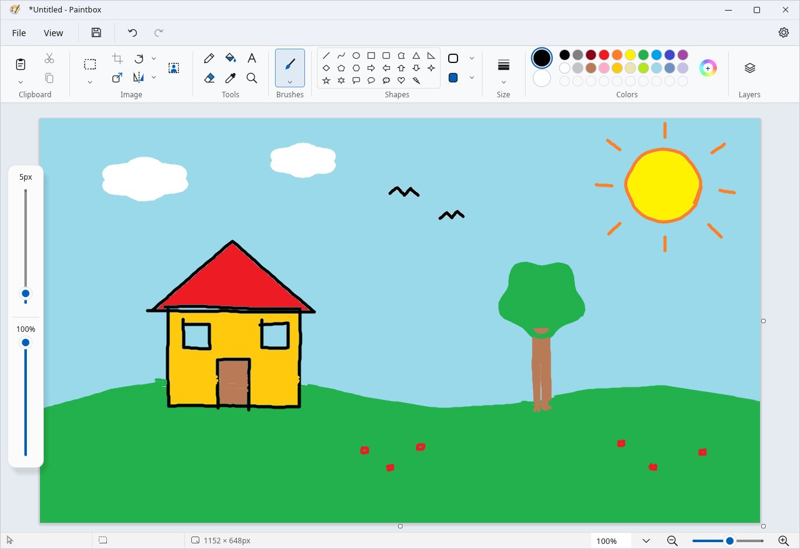
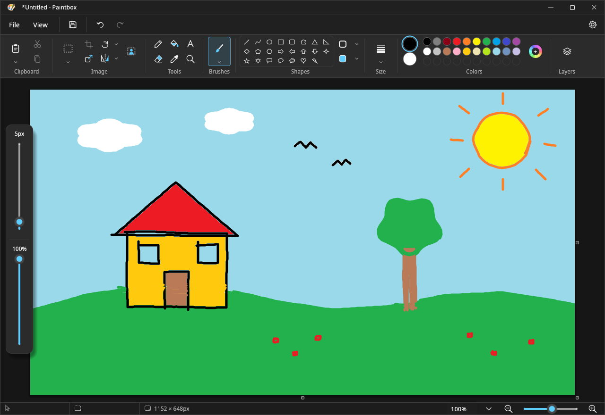
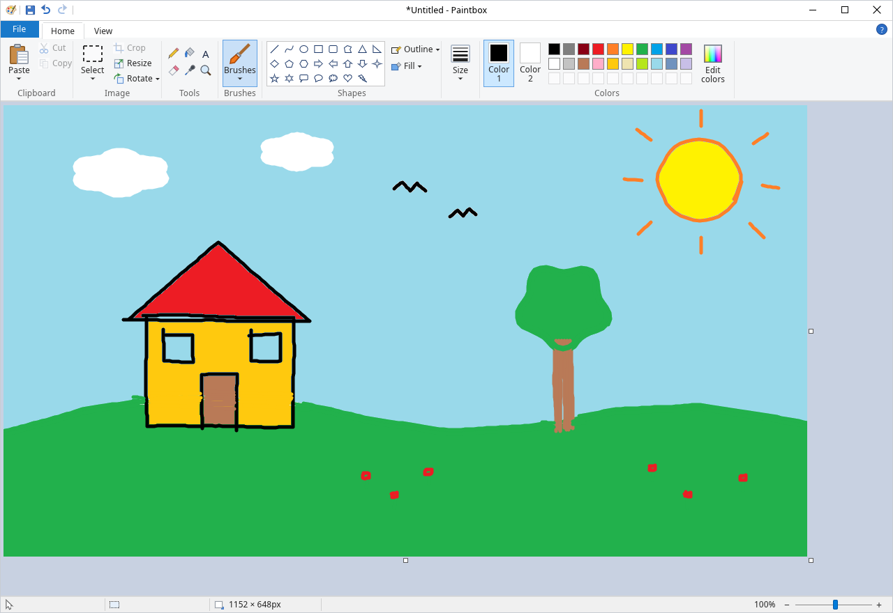
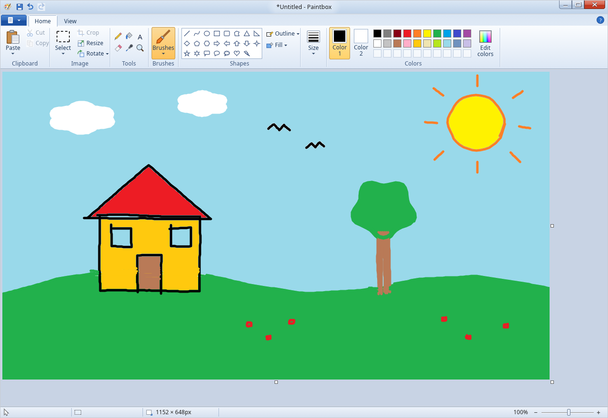

# Paintbox

A simple, familiar paint program for Linux, inspired by **Windows 11 Paint**. It runs on any modern distribution (Ubuntu, Debian, Fedora,
openSUSE, Arch, Mint and others) and desktop (KDE Plasma, GNOME, Cinnamon, Xfce and more). It's written
in Rust with [egui](https://github.com/emilk/egui) and compiles to a single binary.

Formerly known as mspaint-linux.

It follows the Windows 11 Paint layout: the Windows 11 style title bar, the File / View row with quick
Save, Undo and Redo buttons, the toolbar (Clipboard, Image, Tools, Brushes, Shapes, Size, Colors), the
centered canvas with resize handles, and the status bar with a zoom slider. Light and dark themes are
included.

Prefer the older Paint? **Settings → Style** switches to the classic ribbon of Paint in **Windows 10**
(flat title bar, blue File tab) or **Windows 7** (glassy title bar, blue Paint button, orange highlights),
with Home and View tabs, a Text tab while typing, and the picture in the top-left corner. In those
styles, Settings is under the **?** button.

| Windows 11 style | Windows 11 style, dark |
| --- | --- |
|  |  |
| **Windows 10 style** | **Windows 7 style** |
|  |  |

## Features

| Area | What's there |
| --- | --- |
| **Tools** | Pencil, Fill (with tolerance), Text, Eraser, Color picker, Magnifier |
| **Brushes** | Brush, Calligraphy brush, Calligraphy pen, Airbrush, Oil, Crayon, Marker, Natural pencil, Watercolor. The menu shows each brush's stroke, and oil and watercolor run out of paint over a long stroke |
| **Sliders** | Size (pencil, brushes, eraser) and opacity (pencil, brushes) beside the canvas, with a live size preview; tolerance for the fill tool |
| **Shapes** | Line, Curve (two bends), Oval, Rectangle, Rounded rectangle, Polygon, Triangle, Right triangle, Diamond, Pentagon, Hexagon, 4 arrows, 4-, 5- and 6-point stars, 3 callouts, Heart, Lightning |
| **Shape styles** | Outline and fill: none, solid, crayon, marker, oil, natural pencil, watercolor. Shapes stay editable (move or resize with handles) until you click away. Hold Shift for squares, circles and 45° lines |
| **Selection** | Rectangle and free-form, select all, invert, delete (Delete or Backspace), transparent selection, move, resize (Shift keeps the aspect ratio), **free rotation** with the handle above it, Ctrl+drag to copy, Shift+drag to smear, nudge with the arrow keys |
| **Layers** | Layers panel with thumbnails: add, duplicate, merge down, delete, show/hide, drag to reorder. A Background tile (any color, or hidden for a transparent canvas). Transparent areas show a checkerboard, and the eraser erases to transparency |
| **Image** | Crop, Resize and skew, Rotate 90°/180° or Custom rotate (any angle), Flip, Invert colors, Remove background, drag-to-resize canvas |
| **Text** | Any installed font, size, bold, italic, underline, strikethrough (Ctrl+B/I/U), left/center/right alignment, background fill, word wrap |
| **Colors** | Color 1 / Color 2 (right-click or Shift+click a swatch for Color 2), the classic 20-color palette, 10 custom colors, Edit colors (spectrum, value slider, RGB or HSV, hex) |
| **View** | Zoom 10% to 800% (Ctrl+wheel, Ctrl+PageUp/PageDown, slider, magnifier), fit to window, rulers, gridlines, status bar, thumbnail, full screen |
| **Files** | Open / Save / Save as PNG, JPEG, BMP, GIF, TIFF, WEBP and ICO (layers are flattened); also opens TGA, PNM and QOI. Phone photos open the right way up (EXIF orientation). Saving replaces the file safely, so a failed save never leaves a damaged file. Recent files, Import to canvas, Print, drag and drop, open from the command line |
| **Clipboard** | Paste, Paste from file, Cut, Copy and Copy visible layers (Ctrl+Shift+C), shared with other apps (Wayland and X11). Pasting a larger image grows the canvas |
| **Image properties** | Size in pixels, inches or centimeters; Color or Black and white; last saved, size on disk |
| **History** | Undo / redo (up to 100 steps; strokes, shapes and fills store only the area they changed, so big pictures keep a long history). Ctrl+Z in a text box undoes typing |

### Desktop integration

- **Native file dialogs** through the XDG desktop portal (KDE, GNOME and GTK portals).
- **Set as desktop background** (Fill, Tile, Center) on KDE Plasma, GNOME (and Ubuntu, Budgie,
  Pantheon), Cinnamon, MATE, Xfce and LXQt.
- Uses the desktop font (Noto Sans, Cantarell, Ubuntu...) and follows the desktop's light/dark
  preference (Plasma's color scheme, or GNOME's dark style).
- Draws a Windows 11 style title bar by default (drag to move, double-click to maximize, resize from
  the window edges). If you prefer your desktop's own title bar, turn on **Settings (gear) → Use system
  title bar**.
- Native Wayland and X11 support, with a `.desktop` entry so Paintbox shows up in the launcher and under
  "Open with" for images.
- Opens files in your XDG Pictures folder by default.
- Asks to save unsaved work when you close the window.
- Prints through CUPS (Ctrl+P): pick a printer, copies, orientation and fit-to-page.

## Install

Download the file for your system from the
[latest release](https://github.com/addition-official/paintbox/releases/latest) (64-bit; any
distribution from about 2022 on, with glibc 2.35 or newer). No Rust needed.

| System | File | Install |
| --- | --- | --- |
| Ubuntu, Debian, Linux Mint, Pop!_OS, Kubuntu | `.deb` | double-click it, or `sudo apt install ./paintbox_*_amd64.deb` |
| Fedora | `.rpm` | `sudo dnf install ./paintbox-*.x86_64.rpm` |
| openSUSE Tumbleweed, Leap 15.6 | `.rpm` | `sudo zypper install ./paintbox-*.x86_64.rpm` |
| Any distribution, with Flatpak (sandboxed) | `.flatpak` | `flatpak install --user ./paintbox-*.flatpak` (needs the [Flathub remote](https://flathub.org/setup) for its runtime) |
| Any distribution (Arch, Manjaro, Void, ...) | `.AppImage` | `chmod +x paintbox-*.AppImage`, then run it (or double-click it) |
| Any distribution, installed to your home folder | `.tar.gz` | unpack it, then run `./install.sh` inside |

Run the commands in the folder you downloaded the file to. The .deb and .rpm add Paintbox to the
application launcher; remove them with `sudo apt remove paintbox` or `sudo dnf remove paintbox`.

### Updates on Ubuntu, Debian and friends

The .deb (from 0.5.2 on) also adds the Paintbox apt repository, the way the Chrome and VS Code
packages do, so new versions arrive with your other system updates (`sudo apt upgrade`, or the
updates in Discover or Software). It's one file, `/etc/apt/sources.list.d/paintbox.sources`,
which you can read; delete it to turn updates off, or `sudo apt purge paintbox` to remove both.

Rather use apt from the start? Add the repository, then install:

```sh
sudo curl -fsSL -o /etc/apt/sources.list.d/paintbox.sources https://addition-official.github.io/paintbox/apt/paintbox.sources
sudo apt update && sudo apt install paintbox
```

**Coming from "Paint for Linux" (mspaint-linux)?** Paintbox is the same app under a new name. Installing
it replaces the old package and keeps your settings and recent files. Pin it to your taskbar again,
since the launcher entry has a new name.

## Build from source

### 1. Install Rust (one time)

Distribution packages of `rustc` are often too old, so use rustup. First install a C compiler and curl
(`sudo apt install build-essential curl` on Debian/Ubuntu, `sudo dnf install gcc curl` on Fedora,
`sudo pacman -S base-devel curl` on Arch), then:

```bash
curl --proto '=https' --tlsv1.2 -sSf https://sh.rustup.rs | sh
source "$HOME/.cargo/env"
```

### 2. Build and install

```bash
git clone https://github.com/addition-official/paintbox.git
cd paintbox
./install.sh            # installs to ~/.local for the current user
# ./install.sh --system # or for all users, into /usr/local
```

Then open **Paintbox** from the application launcher, or run `paintbox [image]`.
To remove it later: `./install.sh --uninstall`.

### Or build the packages

```bash
cargo install cargo-deb cargo-generate-rpm
./packaging/build-all.sh   # .deb, .rpm, AppImage and .tar.gz in dist/
```

### Just run it

```bash
cargo run --release -- path/to/picture.png
```

The binary only links against libc. It loads OpenGL, Wayland/X11 and xkbcommon at runtime, and every
desktop installation already has them.

## Keyboard shortcuts

| Shortcut | Action |
| --- | --- |
| Ctrl+N / Ctrl+O / Ctrl+S / Ctrl+P | New / Open / Save / Print |
| Ctrl+Shift+S or F12 | Save as |
| Ctrl+Z / Ctrl+Y | Undo / Redo |
| Ctrl+X / Ctrl+C / Ctrl+V | Cut / Copy / Paste |
| Ctrl+Shift+C | Copy visible layers |
| Ctrl+A | Select all |
| Delete or Backspace | Delete selection |
| Ctrl+Shift+X | Crop to selection |
| Ctrl+W | Resize and skew |
| Ctrl+E | Image properties |
| Ctrl+Shift+I | Invert colors |
| Ctrl++ / Ctrl+- | Bigger / smaller brush, line or eraser |
| Ctrl+PageUp / Ctrl+PageDown / Ctrl+wheel | Zoom in / out |
| Ctrl+1 / Ctrl+0 | Zoom to 100% / Fit to window |
| Ctrl+R / Ctrl+G | Rulers / Gridlines |
| Ctrl+Shift+N | New layer |
| Ctrl+Shift+H / Ctrl+Shift+B | Show or hide the background / Background color |
| P, E, B, I, T, Z, S | Pencil, Eraser, Fill, Color picker, Text, Magnifier, Select |
| Ctrl+B / Ctrl+I / Ctrl+U | Bold / Italic / Underline (in a text box) |
| F11 | Full screen |
| Alt+F / Alt+V | Open the File / View menu (then arrow keys and Enter) |
| Middle-drag | Pan the canvas |
| Shift (while drawing shapes) | Squares, circles, 45° lines |
| Ctrl+drag / Shift+drag a selection | Copy / smear it |
| Enter / Esc | Finish the current shape, text or selection |

## Development

```bash
cargo run          # debug build (dependencies are still optimized)
cargo test         # unit tests for the document model, shapes, text and file formats
```

Source layout:

| File | Purpose |
| --- | --- |
| `src/app.rs` | App state, menus, shortcuts, files, dialogs, status bar |
| `src/ribbon.rs` | The Windows 11 style toolbar, which folds groups into drop-downs on narrow windows |
| `src/color_dialog.rs` | The Edit colors and Background color editor |
| `src/canvas.rs` | Canvas view, zoom/scroll, rulers, gridlines, mouse interaction |
| `src/layers_panel.rs` | Layers panel and Background tile |
| `src/tool_sliders.rs` | Size, opacity and tolerance sliders beside the canvas |
| `src/document.rs` | Layers, stroke layer, undo history, selection, pending shapes and text |
| `src/brush.rs` | Pencil, eraser and the artistic brushes |
| `src/shapes.rs` | Shape geometry and rasterization |
| `src/text.rs` | System font discovery and text layout and rendering |
| `src/pixels.rs` | Pixel operations, transforms and file I/O |
| `src/icons.rs` | Vector toolbar icons |
| `src/theme.rs` | Fluent-style light and dark themes |
| `src/fluent.rs` | Windows 11 style radio buttons, check boxes, toggles, sliders and number boxes |
| `src/settings.rs` | The Settings page |
| `src/tiles.rs` | Uploads large pictures to the GPU as tiles |
| `src/desktop.rs` | Wallpaper and light/dark detection for each Linux desktop |

## Contributing

Contributions are very welcome! Bug reports, ideas, fixes, new features, icons (your own, not
Microsoft's), translations, testing on other distributions, or just telling me what feels different
from the real Paint: all of it helps.

- Found a bug or have an idea? [Open an issue](https://github.com/addition-official/paintbox/issues).
- Want to change something? Fork the repo, make your change and open a pull request. Before sending it,
  please run `cargo clippy --all-targets -- -D warnings` and `cargo test` (see Development above).
- Not sure where to start? The issues are a good place, or open one to ask.

## Not included

- Windows 11 Paint's AI and cloud features (Cocreator, Image Creator, generative fill and erase, object
  select, stickers, restyle). Remove background uses a simple non-AI method that works best on plain
  backgrounds.
- Paint's `.paint` project format (layers are flattened when saving).
- Free rotation of shapes and text (selections can be rotated freely; you can select a shape after
  drawing it and rotate that).

## Disclaimer

Paintbox is an independent project inspired by the look and workflow of Paint in Windows 11, 10 and 7. It is not
affiliated with or endorsed by Microsoft, and it uses no Microsoft code or assets. All icons are
drawn in code.

## A note on how this was built

I used AI assistance to write most of the code for this project and this README. The idea, the
direction, the design calls and the testing are mine: I compared it against the real Windows 11 Paint,
decided how every part should look and behave, and sent it back whenever something didn't match.
